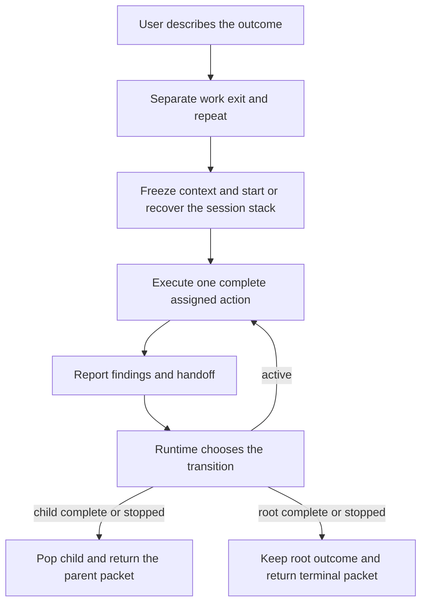
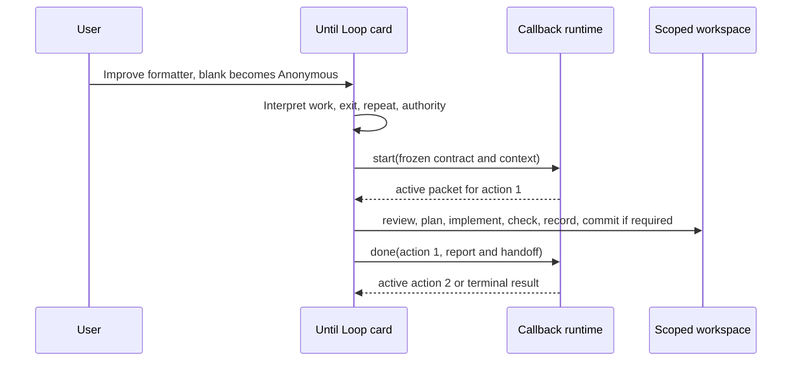
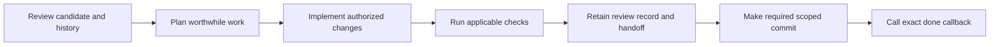
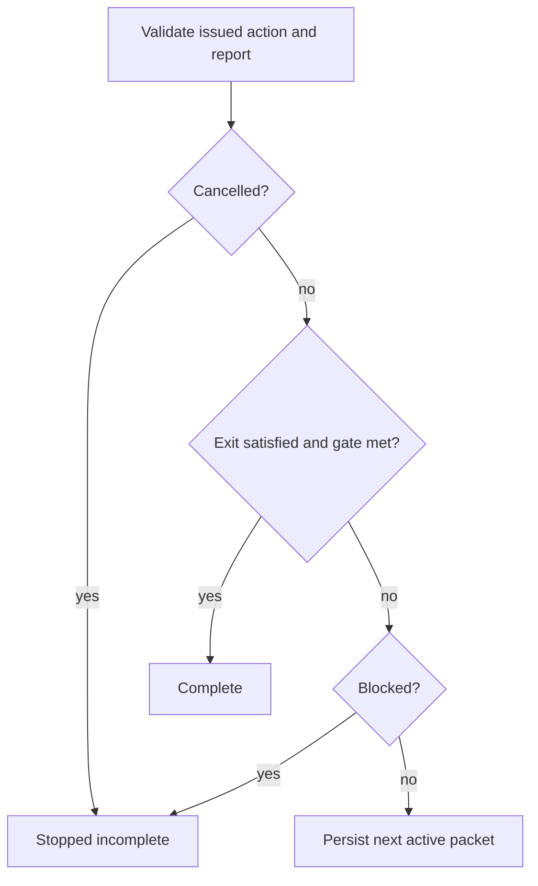
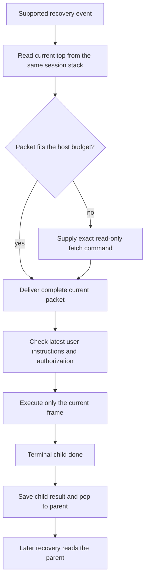
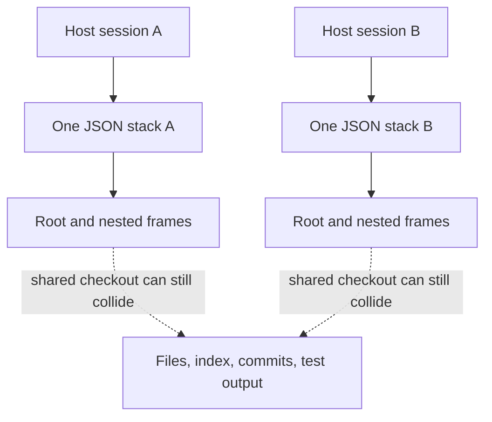

# Until Loop: from a request to a verified stopping point



Until Loop keeps working on a natural-language request until the requested
outcome is established or a real reason to stop is recorded. The model
interprets the request, does the work and judges the evidence; a small Python
runtime preserves the current contract in one private JSON stack per host
session and makes the transition decision. Users describe intent rather than
filling out runtime arguments.

This release is **0.10.1**. Ordinary nested runs share that session file and push
or pop frames automatically; separate host sessions have separate files. There
is no other supported protocol version, background scheduler, hidden worker, or
invocation of **/goal**.

Exit clauses that a command can observe also become **exit checks**: shell
commands the executor writes from the request's own words before any work. The
executor runs them with its own shell tool, through a script the runtime
prints, so host permissions and hooks see every check; the script pipes the
real results to the runtime, which records them and refuses
completion while any fails, so a model cannot talk itself past a clause it
already judged against. A check whose command misstates its clause (a shell or
platform bug) can be repaired; its clause cannot, and every repair is shown in
the result.

The contract is deliberately small. A successful **done** process exit says that
the runtime accepted the callback. It does not establish the user-facing result.
The whole returned packet, current artifacts, checks, and retained task record
are the evidence an executor uses to make that assessment.

## Start with a formatter that needs a repair

Imagine a user says:

> Use Improve on the display-name formatter and its tests and documentation.
> It should trim surrounding whitespace, and blank input should return
> **Anonymous**. Review the last seven full commit messages, plan and implement
> worthwhile changes, and run meaningful checks. Continue until two consecutive
> complete reviews find only trivial or no changes and the behavior and
> documentation agree. Preserve unrelated work, commit changed iterations with
> validation and key learnings, and do not push.

That is an illustrative request, not an assertion about a real formatter, test
result, path, commit, or callback. It shows how the request becomes three
different responsibilities:

These answers may be composed from the request and accepted clarifications;
resolve references once, preserve the exact stop predicates, and freeze the
result before starting.

| Question | Interpreted answer in the story | Why it stays separate |
| --- | --- | --- |
| **Work** | Review the selected formatter candidate and relevant history; plan; implement the fallback if warranted; run applicable checks; record the review; make a required scoped commit before reporting. | It describes one ordered action. |
| **Successful exit** | The formatter and documentation show the requested behavior, current applicable checks pass, no material issue remains, and two consecutive full reviews find only trivial or no changes. | A passing narrow test alone is not enough. |
| **Repeat or incomplete stop** | Continue while useful authorized work or a required review remains; stop incomplete for an actual blocker or a triggered user-prescribed stop. | A stop is not another way to call the request complete. |

This story explicitly requests two qualifying reviews; it does not define
Improve's default policy. Use an explicit user-requested count first, then the
selected caller's default policy. A generic Until Loop request has a default numeric
gate of zero; checking a repair does not add a review requirement.

The interpreter preserves conjunctions, genuine alternatives, conditional
obligations, exclusions, and requested first steps. “CSV or JSON” can be a
successful alternative. “Stop if secret access is needed” is a cancellation
predicate, not “stop if it is needed and unavailable.” A test repetition count
is evidence for that test; it is not a count of qualifying reviews.

For a broad request such as “make it good enough,” the executor derives a
task-specific observable rubric from the target and repository context. It asks
for clarification only when missing scope or acceptance criteria prevents a
valid action or assessment. The maintained interpretation rules are in
[SKILL.md — clause preservation, preview, and sole-caller rules](SKILL.md).

## The lifecycle has one accountable caller

The selected Until Loop card resolves its own runtime, starts or recovers the
current host session stack, executes the returned top-frame action, and consumes
the exact callback return. A nested ordinary start pushes a child; its terminal
callback returns the parent packet automatically. A parent can supply the
natural-language policy, but it must not create a second state machine, type
**/until-loop**, or invoke **/goal**. JSON and arguments are internal transport,
never the user interface.



For an ordinary run, **start** creates or updates the host session's hash-keyed,
mode-0600 JSON stack under `${XDG_STATE_HOME:-~/.local/state}/until-loop` (or
the absolute directory in **UNTIL_LOOP_STATE_DIR**). One file holds the root and
all nested frames; a mode-0600 sibling lock serializes mutations. The session
store is private runtime state, not a project **.until-loop** directory, event
journal, evidence catalogue or cross-session “current run” pointer. Explicit
legacy `--receipt`, `--directory` and `--isolated` starts still create a
per-invocation temporary file. The exact protocol and recovery boundary are documented in
[runtime-ephemeral.md — start, callback, resume, and error contract](references/runtime-ephemeral.md).

The model supplies a complete interpreted contract. The runtime validates its
shape, retains it, issues a random run ID and an action token, and rejects unknown or
malformed fields. The following is **illustrative JSON only**: its paths,
findings, command, and commit receipt are invented. At runtime, **workspace**
must name an existing absolute directory.
The resource paths illustrate an installed Improve package layout.

```json
{
  "workspace": "/work/formatter-example",
  "work": "Review the frozen formatter candidate and the last seven reachable full commit messages; plan worthwhile authorized changes; implement them when warranted; run applicable checks; retain the task record; and make any required scoped commit before done.",
  "exit_condition": "Whitespace is trimmed, blank input returns Anonymous, documentation agrees, current applicable checks pass, no material issue remains, and two consecutive complete reviews find only trivial or no changes.",
  "repeat_condition": "Continue while useful authorized work or a required distinct review remains; stop incomplete on an actual blocker or a triggered requested stop.",
  "required_trivial_reviews": 2,
  "context": {
    "request": "Use Improve on the formatter, tests and documentation. Trim whitespace and return Anonymous for blank input. Read seven full commit messages, plan, implement, check and repeat until two consecutive complete reviews find only trivial or no changes and behavior and documentation agree. Preserve unrelated work, commit changed iterations with validation and key learnings, and do not push.",
    "scope": "Initial base is illustrative commit abc123. Include formatter.py, tests/test_formatter.py, and README.md plus later edits in this run; preserve unrelated staged notes.md.",
    "authority": "Commit only authorized scoped changes after checks. Include Review, Plan, Changes, Validation, Key learnings and Remaining work in the body. No empty commits, no push, and do not absorb unrelated staged content.",
    "environment": "Illustrative environment: run the verified Python command and the selected formatter tests from the workspace; recheck tool availability before relying on it.",
    "resources": [
      {
        "purpose": "selected Improve card",
        "locator": "/opt/example/improve-plugin/skills/improve/SKILL.md"
      },
      {
        "purpose": "bound Until Loop card",
        "locator": "/opt/example/improve-plugin/SKILL.md"
      },
      {
        "purpose": "bound Improve policy",
        "locator": "/opt/example/improve-plugin/skills/improve/references/review-policy.md"
      },
      {
        "purpose": "formatter behavior contract",
        "locator": "/work/formatter-example/README.md"
      }
    ]
  }
}
```

Every new natural-language run supplies all five context fields:
**request**, **scope**, **authority**, **environment**, and **resources**. Each
resource is exactly a nonblank **purpose** and **locator** pair. A locator is
data for a later executor to retrieve; it is never a command, permission grant,
or claim that the referenced artifact is current.

| Fields | Written by | Runtime role | Continuity purpose |
| --- | --- | --- | --- |
| **workspace**, **work**, **exit_condition**, **repeat_condition** | The model, from the authorized request | Validates nonblank fields and existing absolute workspace | Keeps the assigned action distinct from the terminal predicates |
| **required_trivial_reviews** | The model preserves the user's requested or caller-supplied review policy; generic work defaults to zero | Counts only accepted reports; with two or more, also ends after a trivial first pass that left the workspace's Git content unchanged | Makes a review gate mechanical instead of self-reported |
| **context** | The model freezes the accepted request, baseline, authority, environment, and locators at start | Requires the exact schema and returns it unchanged | Lets a fresh executor recover the original constraints |
| **run_id**, **action_number**, **trivial_streak**, **last_report** | The runtime | Owns identity, count, and stored latest report | Prevents a model from choosing a successor or carrying a counter by assertion |
| Report **evidence** and **handoff** | The model, after actual work | Requires nonblank, correctly shaped values | Carries claims and locators forward for rechecking |

Each frame preserves its contract, identity, action number, streak, latest
report, check results, checkpoint and child results. The runtime validates
their structure and transitions, but has no semantic verifier: a report alone
cannot establish that a named test ran, a commit exists, the documentation
matches the report, or the model considered every requirement.

A recovered child also receives `stack.ancestor_limits`, derived from the
saved parent contracts. This carries their scope, authority and continuation
limits without making the child remember or copy its parents. The child's own
success condition stays separate; see the [nested-session contract](references/runtime-ephemeral.md#automatic-nested-sessions).

## Complete the action before reporting it

An active packet contains the workspace, full work and conditions, frozen
context, progress, current report and handoff, a report schema, the exact
**done_argv**, and a read-only **next_argv**. Its action-specific focus directs
attention; it never replaces the entire ordered work body.



For a standalone Improve action, the order is meaningful:

1. Freeze the initial named range or initial HEAD and included staged, unstaged,
   and relevant untracked candidate at start. Later commits do not silently
   select a new candidate.
2. At every distinct review, read the last seven reachable full commit messages,
   or all available messages when fewer exist. History informs the review; it is
   neither the current diff range nor authority to undo prior work.
3. Inspect the candidate, plan worthwhile authorized work, implement it when
   warranted, and run relevant meaningful checks.
4. Retain a host-visible task record with candidate and ownership-aware scope,
   history read, findings, plan or honest no-change reason, actual changes,
   commands/results, lessons, and any commit receipt.
5. After checks pass, make a required scoped commit before calling **done**.
   Its body records Review, Plan, Changes, Validation, Key learnings, and
   Remaining work, including classification and resulting streak.

A no-change review records the reason honestly; it does not manufacture an edit
or an empty commit. An explicit no-commit request keeps the task record without
committing. An explicit audit-commit-every-iteration override may authorize an
identified empty audit commit, but it still must not absorb unrelated staged
content. The executor never resets the user’s index to make the record easier.

[Skill Craft’s Improve — complete review and commit policy](https://github.com/whichguy/skill-craft/tree/main/skills/improve)
expands these choices, including evidence records and no-commit overrides.

The current action ends with a report. Every report includes **handoff**. The
following **full report JSON** is a format example, not an actual callback, formatter result, check result, or commit:

```json
{
  "classification": "non-trivial",
  "exit_assessment": "unsatisfied",
  "continuation_assessment": "allowed",
  "evidence": "Illustrative only: blank input violated the documented Anonymous fallback. Added a failing-then-passing regression, repaired the formatter, checked behavior and documentation, and committed scoped work as def456. Two qualifying reviews remain.",
  "handoff": "Illustrative only: retain the initial baseline abc123 and exclusions in context.scope. HEAD def456 already contains the fallback repair and regression; recheck rather than repeat the edit or commit. Focused checks passed on that candidate. Preserve unrelated staged notes.md. No other known material issue; two complete qualifying reviews remain and no push is authorized. Detailed observations remain in the retained task record."
}
```

| Report field | Accepted values or form | Who judges the meaning |
| --- | --- | --- |
| **classification** | **trivial**, **non-trivial**, or **unresolved** | The model assesses impact and completion; a one-line behavior fix is non-trivial even if already repaired |
| **exit_assessment** | **satisfied**, **unsatisfied**, or **unknown** | The model assesses all substantive exit clauses; unresolved cannot claim satisfied |
| **continuation_assessment** | **allowed**, **blocked**, or **cancelled** | The model identifies useful authorized continuation, an actual obstacle, or a triggered requested stop |
| **evidence** | Nonblank observed account | The model writes actual observations and gaps, never future work or invented proof |
| **handoff** | Nonblank complete replacement summary | The model carries forward candidate identity, decisions, receipts, gaps, and locators; it cannot alter authority or choose a successor |

The script validates the action token and transition fields. Its token is the
random run ID followed by the action number; use the emitted **done_argv**
unchanged, including its `--action=<token>` form. Send the report with structured
arguments and JSON serialization rather than interpolating evidence into a shell
command. Capture actual stdout instead of manually reconstructing the response.
The runtime does not re-grade a semantic review. Each callback reports one
assigned action; incomplete work is unresolved and cannot qualify. Neither
callback retries nor a private sequence of reviews can inflate the streak.

## The runtime chooses the transition



The ordering is intentional: **cancelled** has precedence, then a satisfied
exit plus the numeric gate completes, then **blocked** stops incomplete. A
triggered requested stop is cancelled even when the same fact also describes a
dependency problem. Without that requested stop, an actual obstacle can be
blocked. Neither stopped status establishes success.

For a valid report, **trivial** adds one to the streak. **non-trivial** and
**unresolved** reset it to zero. Before selecting either an active or terminal
result, the runtime encodes and validates the prospective updated state. A
terminal packet retains the number of the just-completed action, not a
hypothetical successor action. A terminal child is saved compactly and returns
the parent's active packet; a terminal root stays in the session JSON. Codex or
Claude can give a passive hook notice, and manual `next` can read the result.
Grok clears its marker and stays quiet on a root terminal. Legacy isolated mode
removes its temporary file at terminal.

The formatter story therefore has exactly this three-action trace:

| Just-completed action | Completed full work | Callback report | Returned packet |
| --- | --- | --- | --- |
| **1** | Review finds a material formatter/documentation defect; it is repaired, checked, recorded, and committed if required. | non-trivial; exit unsatisfied; continuation allowed; streak resets to 0 | **active**, action number **2** |
| **2** | A new full review finds only trivial or no changes and performs current applicable checks and recordkeeping. | trivial; exit unsatisfied; continuation allowed; streak becomes 1 | **active**, action number **3** |
| **3** | Another distinct full review finds only trivial or no changes and establishes all exit evidence. | trivial; exit satisfied; continuation allowed; streak becomes 2 | **complete**, final action number **3**, root result retained |

The table is an illustrative transition trace. It does not say that any
formatter action really occurred. If action 3 instead discovers material work,
its non-trivial classification resets the streak and the runtime returns a new
active action. The loop does not reward cosmetic churn.

When a user correction changes the accepted work, conditions, scope, authority,
or review criteria, the existing immutable contract is stopped as cancelled.
Only an execution request then starts a newly interpreted contract, and the
new run begins with a zero streak. It never carries clean-review credit across
changed criteria.

## Recover the current frame after a host session starts

The plugin uses each harness's supported recovery point. The stack remains the
source of truth: recovery always reads its current top frame, so nested work
survives compaction without a model-held parent-child map.

| Host | Automatic recovery delivery | Limit or boundary |
| --- | --- | --- |
| Codex | `SessionStart` on startup, resume, or compaction injects the current packet. | 32,000 UTF-8 bytes; a corrupt state can stop the turn before another model request. The user must trust the plugin hook. |
| Claude Code | `SessionStart` on startup, resume, or compaction injects the current packet. | 9,500 UTF-8 bytes; a corrupt state can only produce a warning. |
| Grok 1.0.62 | Session start and compaction arm a marker. The next `PreToolUse` gate denies that attempted tool and supplies the packet, or a normal `Stop(end_turn)` gate supplies it for one continuation. | 9,500 UTF-8 bytes. Delivery happens at the next gate, so the first post-compaction model request can happen before recovery arrives. |
| Cursor / OpenCode / Hermes | Portable skill and scripts; a host adapter must supply a stable `UNTIL_LOOP_SESSION_ID` for nesting. | No packaged automatic recovery adapter. The adapter owns recovery; a known `next --state` remains available for inspection. |

Codex and Claude read an atomic session snapshot and inject the current frame
before the model continues. Grok's session and compaction hooks do not inject
context; they set an optional `grok_recovery` marker in the same locked JSON
document. The following gate claims that marker and renders the then-current
top frame. A child push or pop keeps the marker attached to the stack, so a
gate that runs after a transition still reads the right frame. See the
[installed-package walkthrough](docs/until-loop-plugin-readme.md#continue-through-compaction)
for the Grok flow and [the callback and recovery reference](references/runtime-ephemeral.md)
for identity, budget and failure details.



For an active nested loop, recovery selects the current child from disk. On
Grok, that read happens at the next tool or normal turn-end gate rather than
before the first post-compaction model request. An oversized packet uses the
explicit fetch branch before loop work continues.

Recovery does not execute work, advance or cancel a frame, or override newer
user instructions. A child result and saved checkpoint are claims to reassess,
not proof or authority. The session file preserves the frozen context, handoff,
checkpoints and child results; it cannot reconstruct unsaved partial-action
facts.

Automatic recovery requires the installed plugin's hooks to be loaded and
active. Codex also requires the user to review and trust the current hook
definition. A source-only skill symlink or copied card does not install the
plugin hooks. An explicit `UNTIL_LOOP_SESSION_ID` disables automatic adoption;
that adapter owns recovery for its namespace. For an unsupported or untrusted
hook, use an available packet's exact `next_argv`, a known `--state` handle, or
bare `next` with the same host identity. These reads return the current top
frame. Read-only `next --state` works with a known handle even without a host
identity; callback mutations require a matching session identity. Do not use
this path for legacy isolated receipts.

Codex and Claude fork events warn that copied callbacks belong to the source session.
Codex and Claude give a passive status notice for a retained root terminal;
Grok stays quiet after that terminal clears its marker. Missing state is not
created by recovery. A corrupt state can stop Codex before another model
request; Claude can only warn. Grok reports active recovery at its next
supported gate. The bounded fallback supplies an exact `next_argv` if the
fetch command itself fits the host budget.

Validate actual hook delivery separately for the relevant host and version.
Source manifests and package checks do not prove that an installed host enabled
or trusted the hooks. The manual fallback remains available. Official behavior
is documented in the [Codex hook reference](https://learn.chatgpt.com/docs/hooks)
and [Claude hooks reference](https://code.claude.com/docs/en/hooks).

Input rejection and cleanup failure report **state_change: unchanged**. A
filesystem write error can report **state_change: unknown**. When the error
includes a known parsed state handle, its returned read-only refresh command is
for inspection, not automatic replay of work or callback. Session writes use
locked atomic replacement, but the runtime has no transaction replay or
automatic state repair. Host recovery hooks deliver existing loop frames and,
on Grok, maintain a delivery marker; they do not repair state. A write error may leave its outcome uncertain;
read the same session with `next` before proceeding. The runtime rejects
missing, empty, linked or changed state rather than trusting or rebuilding it.

An invalid start or argument-parsing failure may have no known state path and
therefore no packet callback. The adapter limits input-correction retries for
one action to two; that is caller guidance, not another persisted runtime counter.

## Separate host sessions and coordinate workspaces



Each ordinary host session has one opaque, hash-keyed JSON file. Nested frames
share it, and a sibling lock file serializes mutations; the lock is not another
state store. Separate identities create separate session files, but this does
not coordinate edits, Git index operations, commits, or test output in a shared
checkout.

Use separate worktrees for concurrent writers, or make a deliberate ownership
agreement. An independent agent must receive a distinct
`UNTIL_LOOP_SESSION_ID` or its own stable host ID; an agent that inherits the
parent's ID joins that same stack. Do not delete an orphan merely because its
name looks familiar, and do not treat an arbitrary matching file as a lost
task's state. A missing session file is not permission to reconstruct a result.

## Preview and earlier releases are explicit boundaries

An interpretation preview explains the proposed work, success conditions,
continuation and incomplete stops, scope/history window, evidence, first action,
and commit policy. It performs no **start**, **done**, task check, edit, stage,
commit, temporary state creation, or callback. A command the user explicitly
asked to run with its own **--dry-run** flag is still work, not automatically an
Until Loop interpretation preview. A prohibition on all filesystem writes also
forbids the temporary run file.

A workspace **.until-loop** directory left by an earlier release is not a run.
Until Loop never reads, continues or migrates it. The runtime refuses a contract
or saved state without **context** and a report without **handoff** with a clear
error; start a new run instead. If a bare “continue” has more than one plausible
owner, resolve that ambiguity before any mutation.

## Source, generated package, and local skill ownership

The root **SKILL.md**, **scripts/**, **references/**, and supporting metadata are
the authoritative Until Loop source. The generated plugin view is copied into
**plugins/until-loop** by
[sync_plugin_views.py — source-to-package mapping and parity check](scripts/sync_plugin_views.py).
Edit source, then regenerate and verify; do not patch generated copies.

| Distribution | Entry point and callback runtime |
| --- | --- |
| Until Loop source | **SKILL.md** and **scripts/until_loop_ephemeral.py** |
| Until Loop plugin | **skills/until-loop/SKILL.md** and its colocated **scripts/until_loop_ephemeral.py** |
| Skill Craft Improve | Its own card binds **runtime/until-loop/ADAPTER.md** and a vendored copy of this runtime |

The callback runtime requires Python 3.9 or later. Git, test runners and other
tools used by the assigned work remain the workspace's requirements. Copying
only a card is insufficient; an installed package needs its bundled resources.

[Skill Craft’s Improve source](https://github.com/whichguy/skill-craft/tree/main/skills/improve)
is Improve's only home. A source merge in this repository does not update that
vendored copy, change a marketplace pin, publish an immutable release, or
activate a catalog entry.

The following source-only development link exposes the card and runtime; it
does not load recovery hooks. Automatic recovery requires the installed,
enabled plugin and, on Codex, trust of its current hook definition. Use the
[plugin installation instructions](docs/until-loop-plugin-readme.md) for that setup.

For a local Codex checkout, link only the generated Until Loop leaf. Codex
recursively discovers cards beneath each skill entry, so a link to the repository
or plugin root would expose unintended source cards. Regenerate first, then keep
the guard that refuses to replace a user-owned non-symlink:

```sh
python3 scripts/sync_plugin_views.py
mkdir -p "$HOME/.codex/skills"
codex_skill_link="$HOME/.codex/skills/until-loop"
if [ ! -e "$codex_skill_link" ] || [ -L "$codex_skill_link" ]; then
  ln -sfn "$PWD/plugins/until-loop/skills/until-loop" "$codex_skill_link"
else
  printf '%s\n' "Refusing to replace non-symlink: $codex_skill_link" >&2
  false
fi
```

This target contains the one public Until Loop card and its colocated runtime.
If the guard stops, inspect the existing user-owned path manually instead of
overwriting it. Packaging and publication are described in
[PUBLISHING.md — authoritative source, generated view, and release steps](docs/PUBLISHING.md).

## What the tests do and do not establish

| Validation layer | What it checks | Boundary |
| --- | --- | --- |
| Runtime tests | Schema validation, refusal of context-less state and handoff-less reports, stale/cross-run action tokens, link safety, read-only refresh and terminal behavior | They cannot prove semantic interpretation or reported work. |
| Session-stack tests | Nested push/pop, three-level unwind, stale parent callbacks, terminal recovery and cold recovery | Host adapters still need to supply a stable session ID. |
| Package tests | Generated-view parity, relocated package execution through emitted arguments, and local discovery | They do not certify every host. |

From the repository root:

```sh
python3 scripts/sync_plugin_views.py --check
PYTHONDONTWRITEBYTECODE=1 bash tests/until-loop.test.sh
```

These checks exercise deterministic mechanics. A model execution still needs
current authorization, actual tool access, current artifact inspection, and
evidence appropriate to the user’s request.

The formatter story ends when its behavior and documentation have current
supporting evidence, the required reviews have happened, and the runtime returns
**complete**. The session file retains the root terminal packet, which explains
the assignment, last assessment and supporting receipts when recovered with
`next`.

For the complete implementation contract, read
[SKILL.md — interpretation and execution rules](SKILL.md),
[runtime-ephemeral.md — callback schema and failure handling](references/runtime-ephemeral.md)
and [until_loop_ephemeral.py — state validation and transition code](scripts/until_loop_ephemeral.py).
