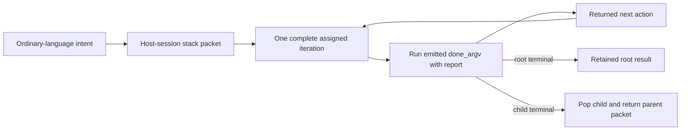
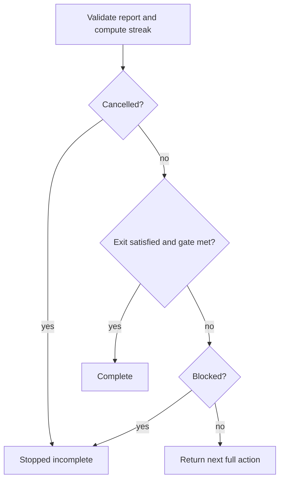
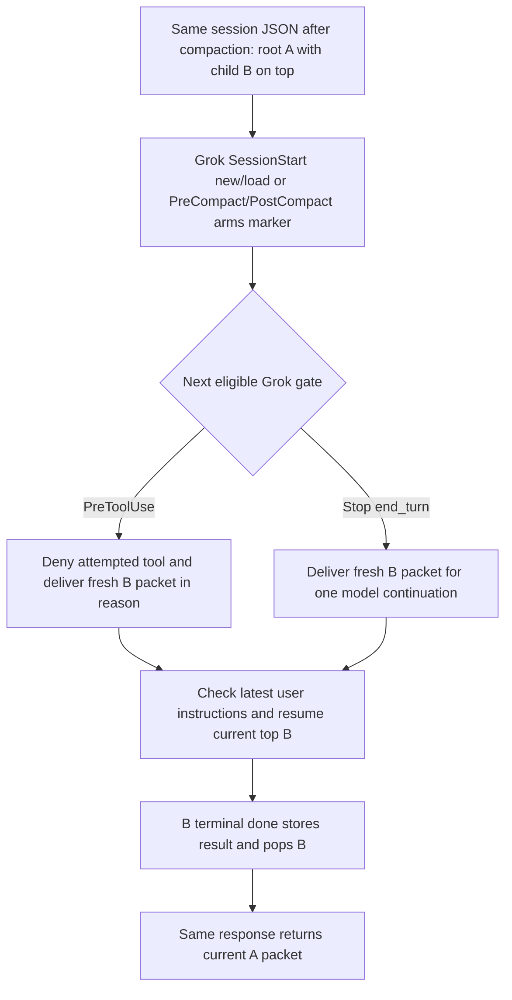

# Until Loop



You ask an agent to fix a formatter and verify its documented blank-name
fallback. It finds the bug, makes a repair, and gets the tests to pass. The next
question is whether that evidence satisfies the whole request, or whether
another action remains. Until Loop makes that decision explicit and returns
the instruction that the skill must execute next.

The skill interprets your request and judges the actual evidence. The script
holds the current session stack in one private JSON file and controls transitions.
This walkthrough describes the installed package; its example observations are
illustrative rather than test receipts.

The installed card derives the work, continuation, and exit conditions from
the user's request. An ordinary `start` uses the stable host-session identity
and one private JSON stack file. The packet names the exact `done_argv` for its
top frame. Perform the full assigned iteration, then send one structured report
to that exact command. A nested ordinary start pushes a child automatically;
the child's terminal `done` stores its compact result and returns the parent's
packet. A root terminal result stays in the file. Codex and Claude can give a
passive SessionStart notice; Grok stays quiet after the root clears its marker.
For an active frame, Grok uses a later tool or turn-end gate. `next` remains a
read-only manual fallback.
The returned instruction owns the next action; do not choose a successor or
privately run extra iterations to satisfy a review gate.

## Use after installation

Start a new host conversation and invoke the installed skill explicitly. For
example:

- `Use $until-loop to finish the importer and verify malformed rows.`
- `Dry-run $until-loop on this proposal; show the work and stopping conditions without changing files.`
- `Use $until-loop to reconcile the remaining reports. Stop when all are accounted for or a required source is missing.`

The card intentionally disables implicit model invocation. A parent skill may
load the card and pass ordinary-language intent, but the parent must not issue
the runtime commands itself or inject another loop driver.

A dry run interprets the requested work and conditions without creating a
state file or performing work. A normal run may continue while useful,
authorized work remains and the exit evidence is incomplete. It ends only when
the callback reports a satisfied exit and any configured review gate is met,
or when the callback reports a real block or explicit cancellation.

The default invocation does not ask the model to choose state paths or receipt
files for nesting. `--receipt`, `--directory`, and `--isolated` remain a legacy
per-run integration mode and never join the automatic session stack. The
installed plugin also registers host-specific automatic recovery; its behavior
and manual fallback are shown below.

## Follow one action from request to response

Before starting the formatter task, the skill distinguishes three obligations:

| Part | Example interpretation |
| --- | --- |
| Work | Inspect the formatter, plan and apply the bounded repair, check its behavior and record the result |
| Exit | The documented fallback and other requested behaviors have current supporting evidence |
| Continuation | Keep working while an authorized gap remains; stop incomplete for a real blocker or a triggered requested stop |

The script stores these sentences but does not interpret their meaning. A
passing test does not erase a separate documentation requirement. “Stop if a
required source is missing” is an incomplete stop, not another way to succeed.
The current card defines those interpretation rules in detail.

The skill then passes the contract as JSON on stdin to the selected runtime's
`start` command. The response contains everything needed for this action:

| Packet field | Why the executor needs it |
| --- | --- |
| `workspace`, `work`, `conditions` | The actual work location, one-iteration body and whole-task conditions |
| `context` | Frozen request, original scope, authority, environment and resource locators |
| `progress` | Current action number, trivial streak and configured review gate |
| `last_report` | Latest assessment, evidence and complete rolling handoff |
| `instruction`, `report_schema` | What to execute now and how to report the result |
| `done_argv`, `next_argv` | Exact completion call and read-only refresh call for this run |

The report after a full action supplies `classification`, `exit_assessment`,
`continuation_assessment`, `evidence`, and `handoff`. The repair is
`non-trivial` because it changes behavior, even if it changes one line.
The skill must do the work before reporting it, then consume the entire return.
Use structured argv and JSON serialization; do not reconstruct action tokens
or interpolate evidence into shell commands.

Generic Until Loop work has a default review gate of zero. If this repair meets
all exit conditions, it can complete immediately. Skill Craft's Improve instead
sets a gate of two: a material repair resets the streak, and two distinct later
qualifying reviews are needed. Repeated test commands or callback retries do
not count as those reviews.



For a nested frame, terminal completion or stop saves its compact result and
returns the parent packet without advancing the parent action. A root terminal
result stays in the session file. Codex and Claude can give a passive hook
notice; Grok stays quiet after clearing its marker. Manual `next` reads the
result. Legacy isolated mode removes its temporary file at terminal and may
retain a receipt.
An error is not a successful transition. Invalid reports are rejected before
mutation; an uncertain filesystem write requires inspecting the known session
rather than replaying work. Read the bundled adapter at
`skills/until-loop/references/runtime-ephemeral.md`, relative to the installed
package root, for the complete transport contract. A source checkout keeps that
same adapter at `references/runtime-ephemeral.md` relative to the repository root.

## Local Codex checkout link

For a local source checkout, link the Codex `until-loop` entry to this generated
card directory rather than the checkout or plugin root. Codex recursively finds
cards below each local skill entry; this target exposes one `SKILL.md` and its
colocated runtime.

From the checkout root, regenerate the view and update the Until Loop link:

```sh
python3 scripts/sync_plugin_views.py
mkdir -p "$HOME/.codex/skills"
codex_skill_link="$HOME/.codex/skills/until-loop"
if [ ! -e "$codex_skill_link" ] || [ -L "$codex_skill_link" ]; then
  ln -sfn "$PWD/plugins/until-loop/skills/until-loop" "$codex_skill_link"
else
  printf '%s\n' "Refusing to replace non-symlink: $codex_skill_link" >&2
  false
fi
```

If the guard refuses the existing Until Loop path, inspect and resolve that
user-owned file or directory manually. This link exposes the skill and runtime,
but does not install or autoload the plugin's Codex `SessionStart` hook.
Automatic Codex recovery requires that hook to be installed and active, and the
user must review and trust its current definition.

## Continue through compaction

The saved stack survives compaction. Codex and Claude read its current top at
`SessionStart`; Grok 1.0.62 arms a marker and delivers the top frame at a later
gate. That timing means the first post-compaction model request can happen
before Grok recovery arrives.

| Host | Recovery point | Host boundary |
| --- | --- | --- |
| Codex | `SessionStart` on startup, resume, or compaction injects the current top. | 32,000 UTF-8 bytes; a corrupt state can stop the turn before another model request. The user must trust the plugin hook. |
| Claude Code | `SessionStart` on startup, resume, or compaction injects the current top. | 9,500 UTF-8 bytes; a corrupt state produces a warning only. |
| Grok 1.0.62 | Session start and compaction arm; the next `PreToolUse` denies its attempted tool with the packet, or `Stop(end_turn)` supplies the packet for one continuation. | 9,500 UTF-8 bytes; no packet is injected at the arm event. |
| Cursor / OpenCode / Hermes | No packaged automatic recovery adapter. | A host adapter must supply a stable `UNTIL_LOOP_SESSION_ID` for nesting and own recovery. A known `next --state` remains available for inspection. |



The marker is optional `grok_recovery` state in the same locked JSON document;
the hook creates no session file, directory or lock when none exists. Session
start (`new`/`load`) and compaction (`manual`/`auto`) hooks do not return model
context. They arm the marker; duplicate or older timestamps are ignored, while
a later PostCompact event may arm recovery again after an earlier delivery.
Child push and pop preserve the marker, so the next gate reads the current top.
The root terminal transition clears it, and a new root starts without an old
marker. Marker writes and hook stdout are not atomic: if delivery is lost after
a claim, a later load or compaction can arm it again.

Grok recovery runs only when `GROK_HOOK_EVENT` matches the native
`hookEventName` and its corresponding PascalCase `hook_event_name` alias,
and `GROK_SESSION_ID` matches the event's `sessionId` and `session_id` aliases.
Subagent hook events are ignored, as are stops other than `end_turn`. It does
not wake on `StopCancelled`, shutdown or `channel_closed`, and has no keepalive.
A `PreToolUse` denial reaches the model through `permissionDecisionReason`; the
attempted tool is denied, but a gate cannot reliably identify every sibling
tool in an already planned parallel batch. Only an oversized packet needs the
exact read-only fetch command after delivery. The next gate otherwise supplies
the complete packet; no acknowledgement or remembered `next` is needed.

Recovery delivers saved task data without changing loop frames; Grok also
maintains its delivery marker. It does not advance a frame, execute work or
override newer user instructions. Recheck the
latest request, and treat checkpoints, child results and prior reports as
claims rather than proof or authority. Unsaved partial-action facts cannot be
reconstructed; checkpoint important facts before nesting. A terminal child's
`done` stores its result and returns the parent's packet without advancing the
parent action.

Codex selects `hooks/codex.json`; the `hooks/hooks.json` file contains Claude's
SessionStart entry plus Grok's guarded hook entries. The guard leaves Claude's
path untouched when `GROK_HOOK_EVENT` is absent, and Grok accepts the plugin
root alias used by Claude's loader. Codex plugin hooks require review and trust;
a source skill symlink or copied card does not autoload them. A missing state
file is not recreated. A fork receives a warning not to use callbacks copied
from its source on hosts with a fork event. `clear` is not a recovery matcher;
a changed identity cannot be guessed.

If a hook is unavailable or untrusted, use an available packet's exact
`next_argv`, a known `--state` handle, or bare `next` with the same stable host
identity. These read the current top frame, not an older packet's remembered
frame. Read-only `next --state` also works with a known handle when no host
identity is available; `done`, `checkpoint` and `record` require a matching
host or explicit session identity even with `--state`. This is session
consistency checking, not an operating-system security boundary. Legacy
isolated receipts are not included in hook recovery. Cursor, OpenCode and
Hermes can use the portable scripts with an adapter-supplied stable session
identity, but this package has no automatic recovery adapter for them.

See `skills/until-loop/references/runtime-ephemeral.md` for the full identity,
budget, failure and fallback contract. Validate live hook delivery separately
for the relevant host and version: source manifests and package tests do not
establish that an installed host enabled or trusted the hooks. See the
[Codex hook reference](https://learn.chatgpt.com/docs/hooks) and [Claude hooks reference](https://code.claude.com/docs/en/hooks)
for their host-level lifecycle behavior.

## Bundled runtime

The installed card is `skills/until-loop/SKILL.md`. Every run uses the colocated
`scripts/until_loop_ephemeral.py` callback runtime. Bind it to the selected
installed card's directory; do not resolve it from the current working
directory, an author checkout, another installed skill, or `PATH`. The package
is self-contained and needs Python 3.9 or later for the callback runtime.
Workspace tools used by the assigned work, such as Git or a test runner, remain
the workspace's own requirements.

Ordinary runs in one host session share a single stack JSON file; separate host
identities get separate files. A sibling lock serializes stack mutations but
does not coordinate project-file edits, Git indexes, commits or test output.
Independent agents that should not nest must receive distinct
`UNTIL_LOOP_SESSION_ID` values or distinct stable host IDs; inherited IDs join
the same stack. Separate worktrees isolate concurrent writers' workspace
changes. A `<workspace>/.until-loop` directory from an earlier release is not a
run; the runtime never reads, continues or migrates it. State or reports without
`context` or `handoff` are refused.

## Package and marketplace state

The package contains runtime resources, not the development test suite or
historical audit workspaces. Its generated files are regular copies, so an
installed Until Loop package works from an arbitrary cache without a sibling
checkout, symlink, or download.

Pushing a source commit to `whichguy/until-loop` makes that source revision
available for review, but it does not by itself publish this version to the
Skill Craft marketplace. Marketplace consumers receive it only after a new
immutable release tag is created and the Until Loop catalog entry is pinned to
that tag. Improve is owned and released by `whichguy/skill-craft`, which
vendors this callback runtime.

## Development verification

The marketplace package includes the runtime resources needed to operate, not
the development test suite. In a checkout of the matching source revision, run:

```sh
python3 scripts/sync_plugin_views.py
python3 scripts/sync_plugin_views.py --check
PYTHONDONTWRITEBYTECODE=1 bash tests/until-loop.test.sh
```

The packaging checks copy the package alone to a fresh location and execute
the callback runtime through its emitted arguments with independent state
files. These checks establish packaged path binding and protocol behavior; they
do not prove that every model will interpret every request correctly.
