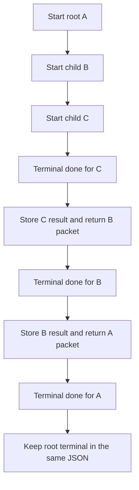
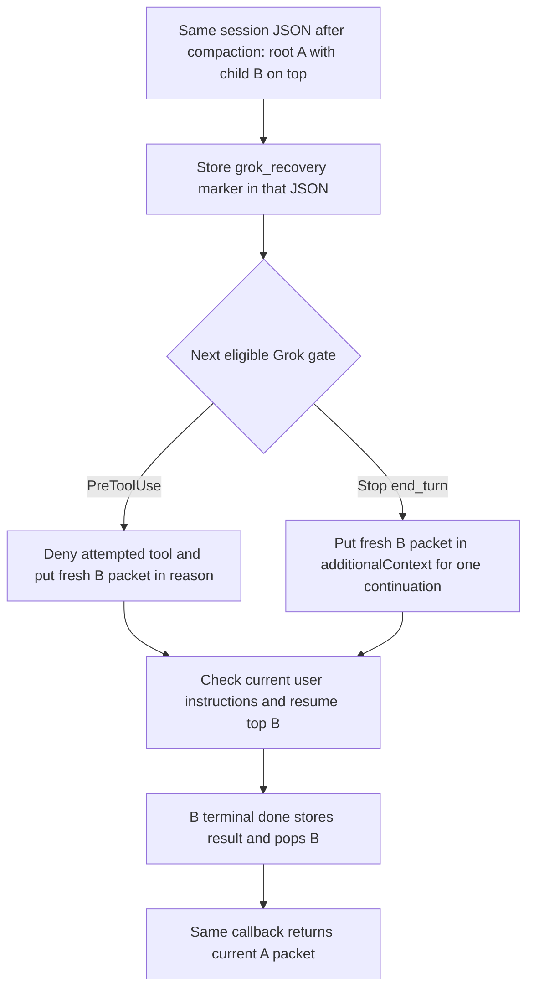

# Session stack and callback adapter

The skill interprets natural language; this adapter stores the session stack,
validates reports and routes each transition. Ordinary invocations use one
authoritative JSON file per host session. Internal JSON and arguments are agent
transport, never a user questionnaire. Explicit legacy isolated integrations
remain available for callers that already use per-run receipts.

## Select and start

Resolve the selected skill's real root, then `scripts/until_loop_ephemeral.py`.
Use the available Python interpreter.

For an ordinary invocation, send its contract to `start` with no
`--directory`, `--receipt` or `--isolated` option. A stable identity is required:
`UNTIL_LOOP_SESSION_ID` overrides the available host identities
`CODEX_THREAD_ID`, `CLAUDE_CODE_SESSION_ID` and `GROK_SESSION_ID`. The runtime
hashes the explicit identity or the sorted present host name/value pairs; it
does not store those raw identifiers in the path. The default store is
`${XDG_STATE_HOME:-~/.local/state}/until-loop`, or the absolute directory named
by `UNTIL_LOOP_STATE_DIR`. A newly created session directory uses mode 0700;
the directory must be owned by the current user and not writable by other users.
The state JSON and sibling `.lock` file use mode 0600; the lock contains no state.
The runtime refuses to guess from cwd or a “latest” file. Ordinary `start` and
bare `next` need a stable identity; `next --state` can read a known stack file
without one. The implementation recognizes `CODEX_THREAD_ID`,
`CLAUDE_CODE_SESSION_ID` and `GROK_SESSION_ID`. Codex and Claude hooks replace
their own identity component with the event's `session_id`; Grok requires
`GROK_SESSION_ID` to match both native event ID aliases. Any other present
native identity variables remain part of the sorted identity set. The hook
process and ordinary start must therefore share the same remaining identity
variables and `UNTIL_LOOP_STATE_DIR` / `XDG_STATE_HOME`. Independent agents that
should not nest need a distinct stable host ID or a distinct explicit override.
For session-backed CLI calls, `done`, `checkpoint` and `record` always require
the caller's matching host or explicit session identity, including when
`--state` is supplied; missing or mismatched identity fails closed. Read-only
`next --state` remains available to an executor holding that exact path. This
is session consistency checking, not a general operating-system security
boundary. Legacy isolated state commands keep their existing behavior.

The first ordinary `start` creates the root frame. While a frame is active, each
ordinary `start` in the same session pushes a child over it. The model does not
select a parent path or perform a pop. Packet callback commands carry the state
path and action token for the selected top frame. `next` without `--state`
recovers that top frame from the same host identity.

When a parent wrote a contract file and names a receipt, keep the existing
legacy command unchanged: `python3 <absolute-script> start --receipt <receipt>
< <contract>`. Do not build, edit or re-serialize the contract; the file wins
over any copy of its text in the argument. This path is deliberately isolated:
`--receipt`, `--directory`, `--isolated`, and the Python `start()` integration
use per-run temporary state and never join or mutate the host session stack. An
existing receipt still follows its legacy active/terminal handling. Do not use
this compatibility path for ordinary nested invocations.

Otherwise the executor builds the contract. A start call needs JSON on stdin:

```json
{
  "workspace": "/actual/existing/workspace",
  "work": "Review the scoped candidate and last seven full commit messages, plan worthwhile fixes, implement them, run relevant checks and record the iteration under the requested commit policy.",
  "exit_condition": "Two consecutive full reviews make no changes, or the first full review completes with no change; relevant current checks pass, and no material issue remains.",
  "repeat_condition": "Repeat while useful authorized work or a required distinct review remains; stop incomplete on an actual blocker or requested stop.",
  "required_trivial_reviews": 2,
  "context": {
    "request": "Improve the named parser candidate; preserve user work and do not push.",
    "scope": "Initial HEAD/base abc123; only parser.py and test_parser.py, including this run's later edits. Preserve unrelated staged notes.md.",
    "authority": "Commit only scoped changes after checks with Review, Plan, Changes, Validation, Key learnings and Remaining work. No empty commits; never push or absorb unrelated staged content.",
    "environment": "Operate in workspace. Use the verified Git/Python executables and run python3 -m unittest test_parser; recheck environment before depending on these observations.",
    "resources": [
      {"purpose": "selected parent skill", "locator": "/resolved/package/skills/improve/SKILL.md"},
      {"purpose": "bound loop skill", "locator": "/resolved/package/SKILL.md"},
      {"purpose": "review policy", "locator": "/resolved/package/skills/improve/references/review-policy.md"}
    ]
  }
}
```

`work` is one iteration, not the entire loop. Preserve requested scope, negative
constraints and order there; retain all outcome and stop predicates in their
respective conditions. The generic gate defaults to zero. A test repetition
count is not a trivial-review count. All four text fields must be nonblank;
workspace must be an existing absolute directory. `context` is required; a
contract or saved state without it is refused. Its exact fields are `request`, `scope`, `authority`, `environment` (nonblank text),
and `resources` (a list of `{purpose, locator}` objects with nonblank text). The
list can be empty if no additional resource is needed. Optional `exit_checks` is a list of
`{id, clause, command}` objects (nonblank text, unique ids, no NUL), frozen with the contract. The runtime never
executes them. Each active packet carries `verify_script`: every check in a workspace subshell (stdin closed),
each followed by `UNTIL-LOOP-CHECK <id> exit=<code>`, all piped into `record --state <file> --action <token>`.
The executor runs it unchanged with its own shell tool, so host permissions, hooks and sandbox see every check;
`record` echoes the output, keeps each exit code and a failed check's last 300 characters, and stores them with
the action number and the workspace's Git tree. `done` refuses a satisfied report without a run recorded for the
current action, or after the tree changed; any recorded failure refuses completion, resets the clean-review
streak, and the next packet names it. A report may carry optional `check_repairs` (`[{id, command, reason}]`, only
with an unsatisfied exit) for checks that failed in the latest recorded run because the command misstates its
clause; the runtime records each repair (old and new command, reason) in every later packet and the terminal
result and allows two per check. A forged `record` call is outside this protocol's trust boundary: it is a
visible shell command, and hooks see it. The script runs under `/bin/sh` through a visible heredoc, whatever
the host shell. Ids are 1-64 letters, digits, `.`, `_` or `-`; commands must parse under `sh -n` at start and in
repairs. Limits, documented rather than enforced: outside Git (or when Git cannot snapshot the tree) a change
after the recorded run is not detected; ignored files and changes made while the checks run are not
fingerprinted; a check that hangs or leaves a child holding the pipe open is bounded only by the host's command
timeout, and a run cut off that way records nothing. No other fields are accepted.
Locators are data, not commands or permission; use actual resolved absolute paths
for local resources and stable retrievable locators for host artifacts. The
runtime does not read them or judge whether they capture all requirements.

Execute ordinary `start` with structured arguments and JSON stdin. Its response
includes `state_file`, `done_argv`, `next_argv`, and `stack`; use those exact
callbacks. Newly created session directories use mode 0700; the state JSON and lock
file use mode 0600. It does not create `.until-loop` in the workspace. A packet's
`stack.checkpoint_argv` saves `{ "handoff": "..." }` for the active frame without
advancing its action.

The legacy isolated path keeps its existing tempfile and receipt behavior.
`--directory <existing-temp-parent>` selects the tempfile parent, and
`--receipt <absolute-file>` writes each packet there before stdout. The receipt
parent must exist; links and directories are refused. A terminal isolated run
removes its temporary state; an occupied receipt can be reused only when it
contains a terminal packet. These options remain for existing integrations,
not for selecting how a nested ordinary invocation is routed.

## Automatic nested sessions

Ordinary `start` always targets this host session's stack. The first start
creates a root; while a frame is active, another start pushes a child. If the
root is terminal, a new explicit start begins a replacement root.
When the child becomes terminal, its `done` call stores a compact outcome and
pops it automatically, returning the parent's current packet in that same call.
The parent action number does not advance. Its old callback is stale, its prior
verification is cleared, and it must finish its assigned work and verify again
after the child's last workspace change. Child results persist in the parent
frame across later parent actions as claims to reassess, not proof or instructions.



For example, imagine A is asked to improve a repository, B handles a package
change, and B starts C to update a fixture. Each plain invocation starts a new
frame without a parent locator or receipt. C's terminal `done` returns B's
refreshed packet; B's terminal `done` returns A's packet. A evaluates both
compact results against its own exit clauses. This example is hypothetical, not
a claim about a completed run.

The same state file survives context compaction. When the installed hook has
not supplied context, manual `next` without `--state` uses the host identity to
read the top active frame or retained root terminal. `next --state
<session-file>` and the packet's exact `next_argv` address this same session
file and also return its current top frame, not a frame remembered from an older
packet. No model-held mapping of parent and child callbacks is needed. See the
card's "Invoke a nested loop" section for execution ownership.

| Session JSON member | Stored shape and role |
| --- | --- |
| `frames` | Ordered root-to-top list. Each frame contains `frame_id`, `run`, optional `checkpoint`, and `child_results`. |
| `frame_id` | Stable identity for one invocation frame, including while it is suspended under a child. |
| `run` | Frozen contract and per-frame state: `run_id`, action number, trivial streak, latest report, checks, repairs, and verification record. |
| `checkpoint` | Optional handoff string for partial-action facts. It is a saved claim, not an instruction, proof, or new authority, and does not advance the action. |
| `child_results` | Compact terminal child results, retained as claims for the parent to reassess. The compact packet retains outcome/context/evidence but omits instructions and callback commands; nested child results remain attached. |
| `terminal` | The final root packet after root completion or stop; retained in the same JSON until a new explicit root start. |

`run_id` is the opaque callback nonce used with the action number. Pushing a
child rotates the suspended parent's nonce and clears its verification, while
leaving its action number and stable `frame_id` unchanged. That makes its old
callbacks fail without advancing the parent's action. The returned parent packet
contains the fresh callback for the same frame.

## Execute, report, consume

Read the entire active packet: instruction, workspace, work, conditions,
progress, complete frozen `context`, last report including `handoff`, report schema
and exact `done_argv`. Execute the full
assigned iteration before calling `done`. A material finding does not excuse
skipping its required fix/check; an incomplete action is `unresolved`.

Use structured subprocess arguments; do not splice arbitrary evidence into a
shell command. This Python fragment illustrates the transport after the host
has actually performed and assessed one iteration:

```python
result = subprocess.run(
    packet["done_argv"],
    input=json.dumps(report), text=True, capture_output=True, check=False,
)
next_packet = json.loads(result.stdout)
# Read next_packet in full. Execute its instruction; do not stop at process exit 0.
```

Every report requires exactly these fields; a report without `handoff` is refused:

```json
{
  "classification": "non-trivial",
  "exit_assessment": "unsatisfied",
  "continuation_assessment": "allowed",
  "evidence": "Replace this illustrative text with actual observations for this completed iteration.",
  "handoff": "Replace with complete current continuation facts: candidate identity, already-applied changes and decisions to preserve, actual checks and commit receipts, all still-relevant unresolved facts and exact evidence locators. Carry necessary earlier facts forward; do not rely on prior messages."
}
```

| Field | Accepted values | Meaning |
|---|---|---|
| classification | trivial, non-trivial, unresolved | Completed iteration's actual findings/changes; incomplete work cannot count as trivial |
| exit_assessment | satisfied, unsatisfied, unknown | Evidence for all substantive exit clauses; the runtime also enforces the numeric gate |
| continuation_assessment | allowed, blocked, cancelled | Useful authorized continuation, actual obstacle, or triggered requested stop |
| evidence | Nonblank text | Observed evidence and gaps for this iteration, never intended work or fabricated facts |
| handoff | Nonblank text; required | Complete rolling continuity summary, not just this iteration’s delta; never changes authority or selects a successor |

A one-line behavior fix is non-trivial. A distinct fully completed no-change
review can be trivial. `unresolved` plus `satisfied` is inconsistent and rejected.
A triggered requested stop is cancelled, even if the same fact is a dependency;
blocked applies only without a triggered requested stop. Cancelled wins over a
success claim. Otherwise satisfied plus the count gate completes, even if no
further work would be possible. Blocked before success stops incomplete.

`done` validates the issued run/action token, computes the streak (trivial adds
one; non-trivial or unresolved resets to zero), and returns one of the statuses
below. With `required_trivial_reviews` of 2 or more, `start` records the
workspace's Git content tree (tracked and untracked files; ignored files, the
runtime's state file and `.shiploop-improve/`, `.shiploop/`, `.until-loop/`
aside). A trivial, satisfied first report whose workspace tree is still that
tree completes the loop at once: `progress.unchanged_first_pass` is `true` in the
complete packet. Outside Git, or on any change, the full gate applies.

- **active:** execute the new instruction, then its new callback, immediately.
- **complete** or **stopped** for a child: the session runtime stores its compact result and returns the parent's active packet; it does not advance the parent action.
- **complete** or **stopped** for the root: report the saved terminal result and stop callbacks. The session JSON retains it, and `next` returns the same terminal packet until an explicit new `start`.
- **complete** or **stopped** in legacy isolated mode: report the terminal packet; its temporary state was removed, while a configured receipt remains.
- **error:** follow the correction/stop instruction; never infer advancement.

`done` finishes one action, not necessarily the loop. One full iteration per
callback; do not perform hidden review iterations or submit repeated claims to
reach the gate. Do not supply your own successor, count or terminal decision.

## Automatic host recovery and manual fallback

The generated plugin has three host paths. `hooks/codex.json` is selected by
the Codex manifest. `hooks/hooks.json` keeps Claude's `SessionStart` entry and
adds guarded Grok entries; they run the Grok adapter only when
`GROK_HOOK_EVENT` is present. The Grok command also accepts the
`CLAUDE_PLUGIN_ROOT` alias used by that loader. All hook commands have a
10-second timeout.

| Host | Recovery events and delivery | Budget and failure behavior |
| --- | --- | --- |
| Codex | `SessionStart` `startup`, `resume`, or `compact` reads the current top and injects it; `fork` gives a source-session warning. | The manifest disables host spilling; the adapter caps output at 32,000 UTF-8 bytes. A corrupt stack returns `continue: false` before another model request. The user must review and trust the hook. |
| Claude Code | `SessionStart` `startup`, `resume`, or `compact` reads the current top and injects it; `fork` gives a source-session warning. | 9,500 UTF-8 bytes, below the documented 10,000-character additional-context threshold. A corrupt stack produces a warning because SessionStart cannot block the turn. |
| Grok 1.0.62 | `SessionStart` `new`/`load` and `PreCompact`/`PostCompact` `manual`/`auto` arm recovery without adding context. The next `PreToolUse` denies that attempted tool and delivers the packet in `permissionDecisionReason`, or `Stop(end_turn)` supplies it in `additionalContext` for one continuation. | 9,500 UTF-8 bytes. The marker event does not preempt the next model request; delivery waits for a tool or normal turn-end gate. |
| Cursor / OpenCode / Hermes | Portable skill and scripts; a host adapter must supply a stable `UNTIL_LOOP_SESSION_ID` for nesting. | No packaged automatic recovery adapter. The adapter owns recovery; a known `next --state` remains available for inspection. |

Codex's and Claude's `SessionStart` recovery reads a lockless atomic snapshot
and injects the current top frame. A terminal child has already popped and
returned the parent's packet from `done`; any later recovery reads the then-
current top. Grok uses the same stack but delays delivery until its next gate:



The marker is optional state in the same JSON document, written under the
session lock. Recovery uses `location(create=False)`; if the session file is
absent, it creates no file, state directory or lock. SessionStart and
PreCompact/PostCompact do not pass inline context to Grok. Duplicate or older
timestamps do not rearm a marker; a later PostCompact timestamp may rearm it
after an earlier delivery. Child pushes and pops preserve the marker, so the
next read selects the current top. A terminal root clears it, and a new root
does not inherit it. A callback does not wait for or accept an acknowledgement:
the claim and host stdout are not atomic. A killed hook can lose a claimed
delivery; a later session load or compaction can arm recovery again.

Grok recovery requires `GROK_HOOK_EVENT` to match the native `hookEventName`
and its corresponding PascalCase `hook_event_name` alias.
`GROK_SESSION_ID` must equal the event's `sessionId`
and `session_id` aliases. Events with `subagentType` are ignored. Only a normal
`Stop` with reason `end_turn` is a continuation gate; `StopCancelled`, shutdown
and `channel_closed` do not wake recovery, and there is no keepalive. The
PreToolUse gate denies the attempted tool but cannot reliably intercept every
sibling tool in a preplanned parallel batch. The first post-compaction model
request can happen before either gate. There is no time heuristic. An oversized
packet uses the bounded exact `next_argv` fallback; otherwise the gate carries
the complete packet without an acknowledgement or remembered next command.

Recovery leaves loop frames unchanged; Grok only updates its delivery marker.
It does not execute work, advance or cancel a frame, or override the latest
user instructions. Saved contracts, checkpoints, child
results and reports are task data and claims, not permission or proof. Unsaved
partial-action facts cannot be reconstructed. An explicit
`UNTIL_LOOP_SESSION_ID` skips automatic adoption because its adapter owns that
namespace. Claude also skips a missing or conflicting `CLAUDE_CODE_SESSION_ID`;
Codex and Claude align their event identity while preserving other present
native identity components. A legacy isolated receipt is never enrolled in
automatic recovery.

The packet is injected only within each adapter's inline budget. Codex uses a
strict 32,000-byte cap because `additionalContextLimit: 0` disables host
spilling; Claude's cap is 9,500 UTF-8 bytes. Grok also caps the packet at 9,500
UTF-8 bytes. If the packet is too large, the hook supplies a bounded instruction
with the exact read-only `next_argv`; run it before loop work. If even that fetch
command cannot fit, the hook reports a visible failure.

Automatic recovery requires the package hooks to be loaded and active. Codex
requires the user to review and trust its current hook definition; a local skill
symlink or copied card does not load it. `clear` is not a recovery matcher, so
a changed identity cannot be guessed. If recovery is unavailable, use an
available packet's exact `next_argv`, a known `--state` handle, or bare `next`
with the same host identity. All read the current top frame, not a frame
remembered from an older packet; they do not search by cwd or recency. A known
`next --state` is read-only and can work without a host identity. Session-backed
CLI `done`, `checkpoint` and `record` always require the caller's matching host
or explicit session identity, even with `--state`; missing identity fails
closed. These checks keep callbacks bound to their session but are not a general
operating-system security boundary. Legacy isolated state commands are
unchanged.

Actual hook delivery needs separate live validation for the relevant host and
version. Unit and relocated package checks establish payload behavior and
manifest wiring, not that a particular installed host enabled or trusted the
hook. Cursor and OpenCode still have the portable skill and manual fallback,
but this package does not provide an automatic recovery adapter for them.
Keep the manual fallback available. A terminal root remains in the same JSON;
Codex and Claude hooks give a passive status notice, while Grok stays quiet
after the root terminal clears its marker. Manual `next` reads the same result.
A new explicit ordinary `start` begins a replacement root. Legacy isolated mode
keeps its separate tempfile and optional receipt behavior.

Host APIs: [Codex hooks](https://learn.chatgpt.com/docs/hooks), [Claude hooks](https://code.claude.com/docs/en/hooks), and [Claude session environment variables](https://code.claude.com/docs/en/env-vars).

## Read and failure handling

`python <absolute-script> next` without `--state` recovers the current host
session's top frame without advancing or rewriting the JSON state; this CLI
read may create the lock sidecar. The host identity selects the
session file; there is no cwd- or latest-file lookup. When a packet supplies an
exact `next_argv`, use it to refresh that session's current top frame. The
equivalent `next --state <exact-session-file>` is available when the session
file path is known; it also returns the current top frame. There is no state
migration or contract-edit command. A missing or invalid session file is an
error and is never recreated by recovery.

If a workspace disappears after its frame was persisted, the frame can still
be stopped with its valid callback; cancellation does not require recreating
the workspace or starting a replacement run.

Invalid schema, stale/cross-run tokens, unsafe linked files and empty state
are rejected. Report input rejection/cleanup failure returns `state_change:
unchanged`. When the failed call supplied a parsed state path, the error includes
`state_file` and the exact read-only `next_argv`; this is not a work callback.
Rehydrate and confirm the same action before correcting input from actual
observations. If an old callback was rejected because it already advanced, follow
the current packet instead of resubmitting old evidence. Do not repeat a completed
iteration merely to replace a lost report. Invalid start/argument parsing without
a known path cannot invent a recovery handle. A filesystem write failure can
return `state_change: unknown`; do not replay the work or initialize replacement
state. Inspect the same file and stop if it is unusable. Limit input-correction
retries for one action to two, then report the protocol problem.

Ordinary session mutations use a sibling lock file; that file is not authoritative
state. Atomic locked writes serialize stack changes, but they are not a crash
journal or transaction-replay system, and no background process or automatic
state repair is installed. Host recovery hooks only read and deliver existing
state. Exit checks run outside the storage lock; `record` reacquires it and
checks the action token before saving results, so a stale recorder cannot
overwrite a newer frame. Session identities get separate JSON files; nested
frames in one host session share its file. Independent sessions still do not coordinate edits,
Git indexes, commits or test output in a shared checkout. Legacy isolated receipt
paths are not locks. An independent agent should get a distinct
`UNTIL_LOOP_SESSION_ID` or stable host ID; an inherited ID joins the same stack.
A killed process may leave an orphan temporary write file. Never delete another
task's file or treat an arbitrary matching filename as this session's state.

A workspace `.until-loop` directory from an earlier release is not a run. This
adapter never reads, continues or migrates it.
